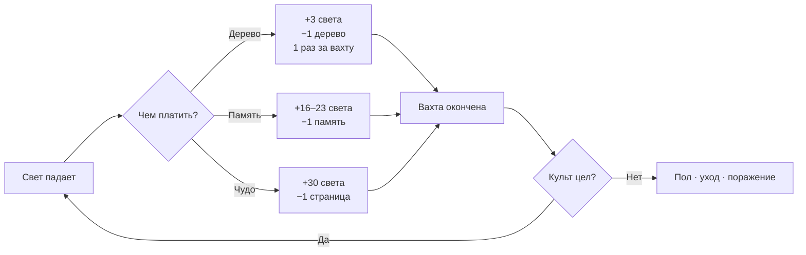

# Saltvigil · «Соляная вахта»

## Геймдизайн-документ v0.2

**Статус:** M0 собран и играбелен. План углублён до вертикального среза M1.
**Движок:** Godot 4.7 (проверяется на 4.7.2).
**Дата:** 19.10.2026.
**Связанные документы:**
[лор-библия](lore/saltvigil-lore-bible-v0.1.md) ·
[нарративный дизайн](narrative-design.md) ·
[техническая архитектура](technical-architecture.md) ·
[продакшн-план](production-plan.md).

---

## 0. TL;DR

1. **Saltvigil** — симулятор культа на спине мёртвого бога. Свет — сердце кита, топливо — память последователей.
2. Один экран, один город, три ночи. Игрок решает, **чьё прошлое сгорит**, чтобы дожить до утра.
3. Крючок — не выживание, а **цена памяти**: сжечь, сохранить или прочесть. Каждое действие необратимо.
4. Демо — 15–20 минут, полная игра — 25–30 часов, 5 регионов, 3 акта, 4 концовки.
5. Модель — премиум-игра $19.99–24.99, честные DLC, без микротранзакций и FOMO.

---

## 1. Видение

### 1.1. Питч

Солнце мертво. Его тело стало миром, его сердце — фонарём, а память людей — топливом.
Ты ведёшь плавучий город по костям мёртвого бога. Пока горит Уголёк, Уэйк жив.
Когда память заканчивается, люди становятся Полами — телами, которые помнят, как держать ложку,
но не помнят, зачем.

**Три ночи. Три человека. Девять воспоминаний. Реши, что ты готов забыть.**

### 1.2. Фантазия игрока

> «Я — хранитель последнего огня. Я не спасаю мир. Я решаю, кем пожертвовать сегодня,
> чтобы завтра ещё было кому помнить».

Игрок не выбирает «добро/зло». Он выбирает между **теплом сейчас** и **человеком потом**.
Каждое сожжённое воспоминание делает культ сильнее и кого-то — меньше собой.

### 1.3. Уникальность

| Что берём у жанра | Что делаем иначе |
|---|---|
| Управление культом (Cult of the Lamb) | Никакого roguelite-цикла и «угарного» юмора. Авторская драма, тихий ужас. |
| Моральные дилеммы (Frostpunk) | Дилемма не в законах, а в **памяти конкретного человека**. Есть имя, лицо и сцена. |
| Эмерджентные истории (RimWorld) | Не процедурные события, а **написанные вручную** сцены + система последствий. |
| Литературный текст (Sunless Sea) | Текст короткий, читаемый шёпотом. Никаких «стен». |
| Открытый мир | Не карта-песочница, а **медленное путешествие** по позвонкам бога. |

**Формула:** *Cult of the Lamb по подаче + Frostpunk по цене решений + свои правила памяти.*

### 1.4. Аудитория

| Сегмент | Доля | Что покупает |
|---|---|---|
| Фанаты CotL / RimWorld / Frostpunk | 45% | Управление, выбор, «ещё одна ночь» |
| Любители нарратива (Disco Elysium, Sunless Sea) | 30% | Текст, атмосфера, концовки |
| Стримеры и TikTok-аудитория | 15% | Яркие моральные моменты, реакции |
| Хардкор-оптимизаторы | 10% | Баланс, стратегии, достижения |

Возраст 18–40. Основные рынки: США, Европа, Россия/СНГ, Китай (после локализации), Бразилия.

### 1.5. Сессия и платформы

- Демо: **15–20 минут** (три ночи).
- Регион полной игры: **60–90 минут**.
- Полное прохождение: **25–30 часов**.
- Платформы: **PC (Steam)**, позже Steam Deck-верификация; консоли — только после 1.0.
- Управление: мышь + клавиатура, геймпад — с M1.
- Сохранение: один слот + чекпоинт на рассвете; отдельный файл настроек.

---

## 2. Столпы и анти-цели

### 2.1. Пять столпов

1. **Память — это топливо.** Любая система должна усиливать вопрос «чем я плачу?».
2. **Люди важнее цифр.** У каждого последователя есть имя, голос и 3–5 памятей. Никаких безымянных юнитов.
3. **Тишина страшнее монстров.** Ужас — в необратимости, а не в скримерах. Никакого gore.
4. **Каждое утро — последствие.** Рассвет показывает, что изменилось, а не просто выдаёт ресурсы.
5. **Честная игра.** Никаких микротранзакций, FOMO, таймеров реального времени и «энергии».

### 2.2. Анти-цели

- **Не roguelite.** Нет случайных забегов; есть авторские акты и накопленные последствия.
- **Не градостроитель-песочница.** Строительство — инструмент выживания, а не самоцель. 8 слотов, не 200.
- **Не пауэр-фэнтези.** Игрок не становится сильнее; он становится **беднее собой**.
- **Не хоррор на скримерах.** Никаких прыжков и мяса. Только соль, холод и забывание.
- **Не «ещё один выживач».** Крафт есть, но служит культу: 5 ресурсов и 5 зданий в демо,
  с M2 — 10 рецептов. Каждый предмет меняет решение, а не прибавляет процент.
- **Не открытый мир «ради галочек».** Открытый мир — это Отмели и маршруты между островами:
  свобода порядка и стоянок, а не 400 иконок на карте.

---

## 3. Эмоциональная дуга

| Время | Что чувствует игрок | Что узнаёт |
|---|---|---|
| 0–60 секунд | Тревога, любопытство | Свет гаснет. Память можно сжечь. |
| Первая ночь | Азарт и вина | Сжечь — быстро. Сохранить — дорого. |
| Первый рассвет | Облегчение с горчинкой | Кто-то стал меньше собой из-за меня. |
| Вторая ночь | Давление | Еды мало. Люди уходят. Чудо стоит страницы. |
| Третья ночь | Решимость | Кем я стал? Что осталось от меня? |
| Финал демо | Тоска и желание переиграть | «А если бы я сохранил её память?» |

**Ключевой эмоциональный пик:** момент, когда игрок впервые видит **Пола** — человека,
которого сам сделал таким. Не монстра. Просто пустое тело с знакомым лицом.

---

## 4. Кор-луп

### 4.1. Внутри вахты (10 секунд)

```
Прочитать состояние → выбрать действие → увидеть последствие → дождаться следующей вахты
```



Действия игрока:

| Действие | Стоимость | Немедленный эффект | Скрытая цена |
|---|---|---|---|
| Сжечь память | 1 воспоминание | +16–23 света, +3 веры, +1 пепла, −3 надежды всем | Человек забывает; риск Пола |
| Сохранить память | 2 воска + Хранилище | +6–9 надежды, +2–3 веры | Память нельзя сжечь |
| Прочесть память | бесплатно, один раз | +1 близость, +1 вера, текст | Ничего? (пока) |
| Покормить Уголёк | 1 дерево, **1 раз за вахту** | +3 света | Дерево нужно на стройку |
| Чудо | 1 страница Журнала | +30 света, +2 веры | Потеря себя; путь к поражению |
| Построить | ресурсы | Производство / надежда | Слот и ресурсы |

### 4.2. Ночь (6 вахт)

```
Сумерки → Первая вахта → Полночь → Глубокая ночь → Серый час → Рассвет
```

- Вахта = **10 секунд** реального времени. Игрок может ставить паузу в любой момент.
- Свет падает каждую вахту: **7 / 8 / 9**.
- Уголёк принимает **одно подношение дерева за вахту**. Дерево — поддержка,
  а не решение: максимум 18 света за ночь против спада 42–54.
  Главный рычаг — память, второстепенный — чудо.
- Каждую вторую вахту — новая строка хроники или барк.
- На рассвете — итог, выбор догмата (с M1), автосейв.

**Кривая давления:** ночь 1 — обучение и первый выбор; ночь 2 — голод и первый Пол;
ночь 3 — Хор, соблазн чуда и финал демо.

### 4.3. Рассвет

1. Сводка: свет, вера, что сожгли/сохранили/прочли, кто ушёл.
2. Восстановление: +5 света (но не ниже 20), +2 веры, +6 надежды и тепла.
   Минимум нужен, чтобы игрок не умирал на первой вахте новой ночи, не успев нажать ни одной кнопки.
3. Выбор догмата: один закон после первой ночи, второй — после второй. Необратимо.
   Если повезло дожить до третьего рассвета, демо заканчивается без нового закона.
4. Автосейв-чекпоинт.

### 4.4. Демо (M0/M1)

Три ночи, три последователя, девять памятей. Финал — «третье утро» и тизер Отмелей.
Цель демо — не пройти, а **захотеть переиграть иначе**.

### 4.5. Полная игра (M2+)

```
Регион → 3–5 ночей → маяк → выбор маршрута → следующий позвонок
```

Между регионами: ремонт Уэйка, новые последователи, торговля, фракции.
Никакой процедурной генерации сюжета; генерация — только ресурсы и погода.

---

## 5. Системы

### 5.1. Уголёк и свет

| Параметр | Значение | Комментарий |
|---|---|---|
| Старт | 45 / 100 | Достаточно на 6–7 вахт без топлива |
| Спад | 7 / 8 / 9 за вахту | Растёт по ночам |
| Порог паники | < 25 | −2 надежды каждому за вахту |
| Ноль | Поражение | «Уголёк погас» |
| Дерево | +3 за 1, 1 раз за вахту | Поддержка, не решение |
| Память | +16–23 | Основной «страшный» ресурс |
| Чудо | +30, −1 страница | Соблазн |

**Правило дизайна:** дерева хватает ровно настолько, чтобы не думать о нём —
и недостаточно, чтобы не думать о памяти. За три ночи спад съедает 144 света;
старт, рассветы и подношения дают не больше 109. Разницу платят памятью или страницами.

### 5.2. Память

**Типы:** радость, горе, навык, связь, тайна, долг.
Тип влияет на текст, ценность и последствия (см. лор-библию §2.5).

**Три действия:**

- **Сжечь** — свет, вера, пепел. Воспоминание исчезает навсегда.
- **Сохранить** — воск, надежда, вера. Память остаётся у культа; человек не становится Полом, пока сохранена хоть одна его память.
  *В M1 формулировка в интерфейсе — «сохранено в памяти Уэйка», чтобы не путать действие со зданием «Хранилище Памяти».*
- **Прочесть** — близость и вера, открывает текст. Один раз на память.

**Пол:** последователь без памятей и без сохранённых. Тело остаётся, человек — нет.
Пол не уходит, не работает и не даёт надежды. Вернуть его можно только новой памятью (M2).

**Правило необратимости:** ни одно действие с памятью нельзя отменить. Подтверждение сжигания — обязательно.

**Искра — особый случай:** она уже Пол. Её три «памяти» — эхо (рисунок, тепло, слово).
Сожжение последнего эха возвращает её в тишину; это отдельный текст и флаг, а не обычный Пол.

### 5.3. Вера, надежда, тепло

| Ресурс | Диапазон | Влияет на | Падение |
|---|---|---|---|
| **Вера** | 0–100 | Скорость спада света, уход людей | < 20: +1 к спаду света |
| **Надежда** | 0–100 на человека | Уход, диалоги | 0 → человек уходит |
| **Тепло** | 0–100 на человека | Надежда | < 60: нет бонуса к надежде |

**Вера культа** — общий счётчик. Полы и уходы бьют по ней. Чудеса и сохранения её поднимают.
**Надежда** — индивидуальная. Голод, тьма и сожжённая память её снижают. Хранилище и рассвет — повышают.

### 5.4. Экономика

| Ресурс | Источник | Сток | Статус |
|---|---|---|---|
| Дерево | старт 8, мастерская +2/вахту | кормление, стройка | есть |
| Воск | старт 2, свечной дом +0.5/вахту | сохранение памяти, стройка | есть (M1) |
| Еда | старт 12, теплица +2/вахту | 0.5 на человека за вахту | есть |
| Соль | старт 4, солеварня +1/вахту | стройка | есть |
| Пепел | сжигание памяти +1 | свечной дом, Хранилище | есть (M1) |

**Решение M1 (закрывает обе дыры):**

- **Свечной дом** — новый дом: **2 дерева + 1 пепел + 1 соль**, производит **0.5 воска за вахту**.
  Пепел появляется только от сжигания памяти. Замыкает цикл:
  сжёг память → пепел → свечи → воск → сохранил память.
- **Хранилище Памяти** — **4 дерева + 1 пепел**, даёт **+1 надежды всем за вахту**.
  Не блокирует сохранение: первый «сейв» доступен сразу (стартовый воск), а устойчиво
  сохранять можно только после того, как появился пепел и Свечной дом.
- Стартовый воск: **2** (вместо 4) — ровно на одно сохранение.
- Пепел также нужен для апгрейдов маяка (M2).

> Ирония экономики: чтобы сохранить чужое прошлое надолго, ты должен сжечь чьё-то другое.
> Это не баг, это тема. Жёсткого замка нет — есть цена.

### 5.5. Строительство

| Здание | Цена | Эффект | Роль |
|---|---|---|---|
| Теплица | 4 дерева + 1 соль | +2 еды/вахту | Еда |
| Мастерская | 4 дерева + 1 воск | +2 дерева/вахту | Топливо |
| Солеварня | 3 дерева + 2 соли | +1 соли/вахту | Валюта |
| Хранилище Памяти | 6 дерева + 2 воска → **4 дерева + 1 пепел** | +1 надежды всем/вахту | Защита людей |
| Свечной дом (M1) | **2 дерева + 1 пепел + 1 соль** | +0.5 воска/вахту | Сохранение |

Слотов: **8**. Здания не апгрейдятся в демо. Одно здание каждого типа (M1), чтобы не ломать экономику.

**Правило:** каждое здание — это выбор. Нельзя построить всё; ресурсы всегда на один дом меньше.

### 5.6. Журнал Хранителя

- Старт: 8 страниц (в полной игре — 20).
- Чудо сжигает 1 случайную страницу навсегда.
- Потерянные страницы видны в интерфейсе — игрок буквально наблюдает, как забывает себя.
- 0 страниц → поражение «Ты забыл всё, что делало тебя Хранителем».
- Журнал — не «мана»: его страницы — единственные тексты о прошлом Хранителя.

**Дизайн-цель:** к третьей ночи у среднего игрока остаётся 3–5 страниц. К финалу — 1–2.

### 5.7. Догматы (M1)

После первого и второго рассвета игрок выбирает один из трёх законов. Выбор необратим.

| Догмат | Эффект | Цена |
|---|---|---|
| **Закон Пепла** | Сжигание даёт +25% света | Сохранение дороже на 1 воск; −2 надежды на рассвете |
| **Закон Сохранения** | Сохранение дешевле на 1 воск (мин. 1) | Сжигание даёт −25% света |
| **Закон Тишины** | Паника при низком свете вдвое слабее | Чудо стоит 2 страницы |

**Принцип:** догмат меняет **экономику**, а не выдаёт «+10% к урону». Игрок должен перестроить стратегию.

### 5.8. Ночь

- 6 вахт по 10 секунд.
- Фазы: Сумерки, Первая вахта, Полночь, Глубокая ночь, Серый час, Рассвет.
- Внутри вахты нет случайных смертей; только последствия решений.
- Модальные окна ставят время на паузу (таймер запоминает остаток).
- Выход в меню сохраняет текущее состояние (кроме поражения/финала).

### 5.9. Экспедиции (M2)

- Уэйк встаёт на якорь у острова; игрок отправляет 1–2 последователей.
- Экспедиция — короткая сцена выбора (3–5 решений), а не платформер.
- Риск: потеря памяти, Пол, встреча с Хором.
- Награда: стекло, шёлк, кость, новые памяти, карта.
- Свет Уэйка продолжает гаснуть, пока группа снаружи — время не останавливается.

### 5.10. Поражение и чекпоинты

| Условие | Текст | Что происходит |
|---|---|---|
| Свет = 0 | «Уголёк погас…» | Поражение, экран «Тишина» |
| Все ушли/Полы | «Уэйк опустел…» | Поражение |
| Журнал = 0 | «Ты забыл всё…» | Поражение |
| 3 ночи прожиты | «Третье утро» | Финал демо |

**Чекпоинт:** автосейв на каждом рассвете. Смерть возвращает к последнему рассвету —
это снижает цену ошибки, но не отменяет её. Финальный экран показывает, что потеряно безвозвратно.

---

## 6. Баланс

### 6.1. Бюджет одной ночи (M1, расчёт)

| Статья | Ночь 1 | Ночь 2 | Ночь 3 |
|---|---|---|---|
| Спад света | 7 × 6 = 42 | 8 × 6 = 48 | 9 × 6 = 54 |
| Еда (3 чел.) | 9 | 9 | 9 |
| Дерево на кормление (эквивалент 42 света) | ~14 | ~16 | ~18 |
| Доход мастерской | +12 | +12 | +12 |
| Доход теплицы | +12 еды | +12 | +12 |
| Разрыв | −2 дерева | −4 дерева | −6 дерева |
| Чем закрывать | стартовый запас | сжигание 1 памяти | сжигание 1–2 памятей |

Стартовый запас дерева (8) и постройки съедают разрыв ночи 1. Ночи 2–3 требуют
либо чуда, либо памяти. **Это и есть крючок: к третьей ночи безопасных решений не остаётся.**

*Таблица не учитывает стоимость построек (мастерская, теплица, свечи). С ними дефицит
наступает раньше — поэтому «просто кормить деревом» перестаёт работать уже во вторую ночь.*

### 6.2. Что показала симуляция M0

Модель повторяет правила `GameState` (без случайности, 1000 прогонов на стратегию):

| Стратегия | Победа | Средний день | Свет в конце | Живых |
|---|---|---|---|---|
| Ничего не делать | 0% | 2.0 | 0 | 3 |
| Только кормить деревом | 0% | 2.0 | 0 | 3 |
| Мастерская + теплица + кормление | 100% | 3.0 | 16 | 3.0 |
| Только Хранилище | 0% | 2.0 | 0 | 3 |
| Сжигать всё при тьме | 100% | 3.0 | 55 | 1.0 |

**Вывод:** каркас проходим, но «правильная» стратегия не заставляет сжигать память —
она лишь позволяет *дожить*. Крючок работает как страховка, а не как сердце игры.
Это лечится балансом M1, а не новыми системами.

### 6.3. Целевые метрики M1

| Метрика | Цель | Как измеряем |
|---|---|---|
| Дошли до третьего утра | 65–75% | Телеметрия плейтеста |
| Сожгли ≥1 память | 90% | Флаги партии |
| Сохранили ≥1 память | 55% | Флаги партии |
| Получили ≥1 Пола | 35–45% | Флаги партии |
| Переиграли иначе | 50% | Опрос + повторные запуски |
| Поняли крючок без объяснений | 80% | Вопрос после сессии |
| Медианная сессия | 15–22 мин | Телеметрия |

### 6.4. Правки M1

1. Спад света: **6/7/8 → 7/8/9**.
2. Свечной дом: **0.5 воска/вахту**, цена **2 дерева + 1 пепел + 1 соль**.
3. Хранилище: **4 дерева + 1 пепел**, +1 надежды всем за вахту; сохранение не блокирует.
4. Старт: воск **2**, остальное без изменений.
5. Чудо: +30 света, −1 страница (без изменений).
6. Сжигание: +16–23 света, +1 пепел (без изменений).
7. Догматы после 1-го и 2-го рассвета.

**Проверка:** headless-симулятор (`tests/balance_sim.tscn`, M1) прогоняет 5 стратегий
и падает в CI, если win rate «правильной» стратегии выходит за 55–85%.

### 6.5. Все ручки

`data/config.json`: ночи, вахты, секунды, спад, стартовый свет, ресурсы, еда,
кормление, чудо, страницы, воск, надежда/вера, пороги паники и веры, рассвет, слоты.
`data/buildings.json`: цены, производство, надежда.
`data/memories.json`: свет, надежда, вера, близость.
`data/doctrines.json`: модификаторы.

Ни одной балансной константы в коде. Всё проверяется headless-тестами и симулятором.

---

## 7. UX/UI

### 7.1. Экраны

```
Главное меню
  ├─ Новая вахта
  ├─ Продолжить (чекпоинт)
  └─ Выход
Игровой экран
  ├─ Палуба (центр): Уголёк, токены людей, 8 слотов
  ├─ HUD (верх): ночь, вахта, фаза, свет, вера, ресурсы
  ├─ Культ (слева): имена, память, надежда
  ├─ Хроника (справа): 8–12 последних строк
  ├─ Панель действий (низ): кормить, чудо, строить, журнал, пауза, сохранить
  └─ Модальные окна: память, стройка, журнал, рассвет, поражение, финал
```

### 7.2. Обучение (первые 60 секунд)

| Секунда | Подсказка | Цель |
|---|---|---|
| 0–8 | «Уголёк гаснет. Дерево — это свет.» | Понять кормление |
| 8–20 | «Нажми на Миру. У неё есть память.» | Открыть карточку |
| 20–35 | «Сжечь — быстро. Сохранить — навсегда.» | Понять выбор |
| 35–60 | «Построй то, что прокормит Уэйк.» | Понять стройку |

Правила: не более 1 подсказки одновременно; подсказка исчезает после действия;
никаких текстовых стен; всё повторяемо в журнале обучения (M2).

### 7.3. Информационная иерархия

1. **Свет** — всегда виден, крупно, меняет цвет при < 25.
2. **Угроза** (кто уходит / Пол) — всплывающая строка, звук.
3. **Ресурсы** — компактно, без иконок в M0.
4. **Память** — только по клику; не засорять экран.
5. **Лог** — контекст, не основной канал.

### 7.4. Чтение состояния без цвета

- Свет: число + полоса + пульсация Уголька.
- Надежда: дуга вокруг токена + число в карточке.
- Опасность: текст + тряска + звук, не только красный.
- Режим стройки: пульсирующие рамки + курсор.

### 7.5. Доступность

- Масштаб шрифта 100/125/150%.
- Полноэкранный режим, VSync, ограничение FPS.
- Скорость вахты: 10 / 15 / 20 секунд (для тех, кому быстро).
- Цветовая слепота: формы и подписи дублируют цвет.
- Отключение тряски и вспышек.
- Полное переназначение клавиш (M2).
- Пауза в любой момент, включая модальные окна.

### 7.6. Геймпад (M1)

- Полная навигация по фокусу: стик/D-pad, A — выбор, B — назад.
- Модальные окна забирают фокус; фон недоступен.
- Подсказки кнопок внизу экрана.
- Никаких действий, требующих точного курсора.

---

## 8. Аудио и визуал (краткий бриф)

### 8.1. Визуальный язык

- 2D, cutout-анимация, крупные силуэты, тёплый свет на холодном фоне.
- Палитра: глубокий сине-зелёный, соль, янтарь, пепел. Один акцент — Уголёк.
- Пропорции: 2.5–3 головы, крупные руки, тяжёлые ткани.
- UI — «книга вахты»: пергамент, латунь, стекло, но без скевоморфизма.
- Анимация: 8–12 fps для персонажей, 60 fps для света и воды.

### 8.2. Звук

- Эмбиент: ветер, скрип дерева, далёкая вода, треск фитиля.
- Музыка: 4 темы (Уэйк, Хор, Тишина, рассвет), 2–4 минуты, loops.
- SFX: 60–80 звуков в полной игре; 15 — в демо.
- Голос: без озвучки диалогов; вокализы Хора — часть саундтрека.
- Тишина — инструмент. В ключевых сценах убирать всё, кроме дыхания.

---

## 9. Содержание M1 («Первая ночь»)

| Элемент | Количество | Критерий готовности |
|---|---|---|
| Авторские сцены | 6 | Проигрываются по триггерам, не ломают сохранение |
| Барки | 20–25 | Не повторяются в одной партии |
| События ночи | 4 | 2–3 выбора, последствия в логе и флагах |
| Догматы | 3 | Меняют экономику, видны в HUD |
| Обучение | 4 шага | 80% тестеров проходят без помощи |
| Звук | 15 SFX + 1 эмбиент | Не раздражает на loop |
| Настройки | 6 | Сохраняются отдельно от партии |
| Геймпад | полный | Все экраны проходимы без мыши |

**Критерий готовности M1:** 70% тестеров доходят до третьего утра, 50% переигрывают иначе,
нет блокирующих багов, 60 fps на целевом железе.

---

## 10. Метрики и плейтест

**Кого зовём:** 8–10 человек, 3 из них не играли в CotL/RimWorld.
**Формат:** 30 минут, без подсказок, think-aloud, запись экрана.
**Что смотрим:** где застревают, когда впервые сжигают память, что говорят вслух,
понимают ли, почему человек стал Полом.
**Что спрашиваем:** «Что решает игра?», «Что ты почувствовал, когда сжёг?»,
«Что бы сделал иначе?», «Кому бы рассказал?».
**Решение по итогам:** если < 60% поняли крючок — чинить обучение, не баланс.

Телеметрия (опционально, с согласия): старт, первое сжигание, первый Пол, рассветы,
поражения, финал, повторные запуски. Без персональных данных.

---

## 11. Риски

| Риск | Вероятность | Влияние | Митигация |
|---|---|---|---|
| Крючок не считывается | Средняя | Высокое | Плейтест до арта; обучение; один экран |
| Текст перегружает | Средняя | Среднее | Короткие строки, «шёпот», лимит 2 абзаца |
| Баланс слишком мягкий | Высокая | Высокое | Симулятор, целевые win rate, M1-правки |
| Арт дороже бюджета | Высокая | Высокое | Cutout, 6 персонажей, переиспользование |
| Ветвление сюжета растёт | Средняя | Высокое | 4 концовки, флаги вместо деревьев |
| Потеря сохранения | Низкая | Критическое | Атомарная запись, бэкап, миграции |
| Выход на Steam без вишлистов | Средняя | Высокое | Страница за 6–9 мес, демо, Next Fest |

---

## 12. Открытые решения

1. **Экономика M1 без жёсткого замка:** пепел нужен для свечей и Хранилища. Подтвердить после плейтеста.
2. **Тон:** насколько мрачно. Сейчас — тихая хтонь без gore. Нужен ориентир: 70% мрак / 20% тепло / 10% чёрного юмора?
3. **Арт:** cutout или sprite-sheet. Зависит от бюджета и художника.
4. **Команда:** соло, соло + художник, 3–4 человека.
5. **Сроки и бюджет:** нужен коридор, иначе план M2–M4 — сценарии, а не обещания.
6. **Юрлицо для Steam:** РФ / Казахстан / Грузия / Армения / паблишер.
7. **Имя ребёнка:** Искра или другое — сейчас Искра, чтобы не путать с пламенем Уголёк.

---

## 13. Что дальше

1. Пользователь запускает M0 и присылает фидбек.
2. Правки M1 по этому документу: экономика, догматы, обучение, звук, геймпад.
3. Плейтест 8–10 человек.
4. Только после этого — арт-библия и M2.
