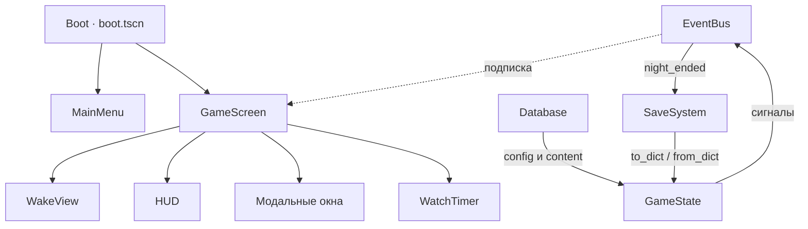

# Saltvigil · Техническая архитектура

**Версия:** 0.2 · 19.10.2026
**Движок:** Godot 4.4+ (CI на 4.7.2), GDScript, GL Compatibility.
**Принцип:** маленькая игра, которую можно поддерживать годами без героизма.

---

## 1. Цели

| Цель | Метрика |
|---|---|
| Стабильность | Ноль блокирующих багов в демо; сохранение не теряется никогда |
| Производительность | 60 fps @ 1080p на встроенной графике; 40+ fps на Steam Deck |
| Поддерживаемость | Ни один файл не больше 350 строк; правила покрыты тестами |
| Расширяемость | Новый контент — JSON, без правки кода |
| Прозрачность | Любой баг воспроизводится по сохранению и логу |

**Ограничения:**
- Только 2D, без 3D и без тяжёлых шейдеров.
- Один поток; никаких фоновых загрузок в демо.
- Один слот сохранения; настройки — отдельный файл.
- Без внешних SDK в M1, кроме Steamworks на этапе M4.

---

## 2. Обзор

```
boot.tscn
  └─ Boot (Node)
       ├─ MainMenu (Control)
       └─ GameScreen (Control)
             ├─ WakeView (Control)      — палуба, слоты, токены
             ├─ HUD                     — верх, культ, хроника, низ
             ├─ Modals                  — память, стройка, журнал, итоги
             └─ WatchTimer (Timer)

Autoload:
  EventBus → Database → GameState → SaveSystem
```



**Правило порядка автозагрузок:** `Database` обязан загрузиться до `GameState._ready()`;
`GameState` — до `SaveSystem._ready()` (подписка на сигналы). Порядок зафиксирован в `project.godot`.

### 2.1. Контракты автолоадов

| Автолоад | Владеет | Может вызывать | Не должен |
|---|---|---|---|
| **EventBus** | Только сигналы | Ничего | Хранить состояние |
| **Database** | Контент из `res://data/*.json` | FileAccess, JSON | Менять состояние игры |
| **GameState** | Правила, ресурсы, последователи, флаги | Database, EventBus | Знать о UI и сценах |
| **SaveSystem** | Файл сохранения, версии, бэкапы | GameState.to/from_dict, EventBus | Менять правила |

**Запрещено:** вызывать `_private`-методы другого автолоада; обращаться к UI из `GameState`;
хранить игровые данные в `MainMenu`/`GameScreen`.

---

## 3. Данные

### 3.1. Файлы

| Файл | Содержимое | Версия |
|---|---|---|
| `config.json` | Баланс: ночи, вахты, свет, ресурсы, цены | `version` |
| `items.json` | Ресурсы: id, имя, цвет, описание | — |
| `buildings.json` | Цены, производство, надежда | — |
| `followers.json` | Стартовые последователи и их памяти | — |
| `memories.json` | Тексты, тип, свет, надежда, вера | — |
| `journal.json` | Страницы Журнала Хранителя | — |
| `doctrines.json` | Догматы и модификаторы | `status` |
| `events.json` (M1) | Ночные события и выборы | — |
| `barks.json` (M1) | Короткие реплики | — |

### 3.2. Правила загрузки

1. Все файлы читаются один раз при старте.
2. Ошибка JSON не роняет игру: `Database.errors` пополняется, используется fallback.
3. Ссылочная целостность проверяется на старте (владелец памяти, id зданий).
4. Порядок зданий/предметов сохраняется отдельными массивами (`building_order`, `item_order`),
   потому что `Dictionary` в Godot не гарантирует порядок для UI.
5. В M1 добавляется JSON Schema-валидация в CI (`tools/validate_content.py`).

### 3.3. Моддинг

- Контент отделён от кода с первого дня.
- В M5 — загрузка `user://mods/<name>/data/*.json` с приоритетом над `res://data`.
- Конфликты id: мод переопределяет запись; в лог пишется предупреждение.
- Скрипты модов не поддерживаются (безопасность и совместимость).

---

## 4. Игровое состояние

### 4.1. Разделение

- **Правила** — чистые функции и данные в `GameState`/`core/`.
- **Представление** — `GameScreen`, `WakeView`, панели. Ничего не решают.
- **Связь** — только `EventBus`.
- **Сохранение** — снимок `GameState.to_dict()`; UI не сохраняется.

### 4.2. API действий

| Метод | Возврат | Гварды |
|---|---|---|
| `burn_memory` | `bool` | живая партия, память существует |
| `keep_memory` | `bool` | живая партия, память есть, хватает воска |
| `read_memory` | `bool` | живая партия, ещё не прочитана |
| `feed_wood` | `bool` | живая партия, есть дерево |
| `miracle` | `bool` | идёт ночь, есть страницы |
| `build` | `{ok, message}` | живая партия, слот свободен, хватает ресурсов |
| `advance_watch` | `void` | идёт ночь, не пауза |

**Правило:** любой метод, меняющий состояние, проверяет `can_act()` и не бросает исключений.
UI обязан показать причину отказа, а не молчать.

### 4.3. Детерминизм

- Случайность — только выбор потерянной страницы журнала (`RandomNumberGenerator`).
- В M1 состояние RNG сохраняется, чтобы перезагрузка не меняла исход.
- Все остальные события — авторские, без рандома.
- `Time.get_datetime_string_from_system()` используется только в метаданных сохранения.

---

## 5. Сохранения

### 5.1. Формат

```json
{
  "version": 1,
  "saved_at": "2026-10-19T21:00:00",
  "state": { "day": 1, "watch": 6, "light": 27.0, "..." : "..." }
}
```

### 5.2. Надёжность

| Механизм | Реализация |
|---|---|
| Атомарная запись | Пишем в `.tmp`, затем `rename` |
| Резервная копия | Перед заменой копируем текущий файл в `.bak` |
| Восстановление | `load_game()` пробует основной файл, затем `.bak` |
| Валидация | Проверка версии, типов и диапазонов в `from_dict` |
| Битые данные | Неизвестные поля игнорируются; числа зажимаются |
| Тесты | Отдельный `user://saltvigil_test_save.json`, удаляется после прогона |
| Мёртвые состояния | Сохранение после поражения/финала запрещено |
| Финал демо | Чекпоинт удаляется, «Продолжить» исчезает |

### 5.3. Версии и миграции

- `SAVE_VERSION` увеличивается при изменении схемы.
- Загрузка сохранения с версией выше текущей запрещена.
- Для старых версий — функции `_migrate_v1_to_v2()` (M2), а не «угадывание».
- Политика: демо-сохранения не обязаны переноситься в EA; сохранения EA — обязаны.

### 5.4. Чекпоинты

- Автосейв на каждом рассвете.
- Ручное сохранение доступно во время ночи (кроме паузы на модальном окне — по желанию).
- Смерть возвращает к последнему чекпоинту (обычно рассвет); финальный экран перечисляет необратимые потери.

---

## 6. UI-слой

### 6.1. Принципы

- Один `Theme` на игру (кэшируется), а не на экран.
- Панели создаются кодом в M0/M1; в M2 — сцены для художника.
- Модальные окна — стек из одного уровня; фон недоступен.
- Фокус сбрасывается при открытии модала, чтобы клавиатура не нажала кнопку под ним.
- Все тексты — через ключи локализации (M3), сейчас строки в JSON и коде.

### 6.2. Перестройка

- Списки перестраиваются только по сигналам `followers_changed`/`buildings_changed`.
- Двойные сигналы в одном кадре коалесцируются через `call_deferred` (M1).
- Лог обновляется инкрементально, не через полный join каждый кадр.
- Таймер вахты не перезапускается при открытии модала, а ставится на паузу.

### 6.3. Тосты

- Очередь, максимум 3 одновременно, вертикальный стек.
- Время жизни 1.7–2.5 секунды, без наложения.
- Критичные сообщения (Пол, уход) не тост, а строка хроники + звук.

---

## 7. Производительность

### 7.1. Бюджет кадра

| Система | Бюджет |
|---|---|
| Логика/UI | ≤ 4 мс |
| Отрисовка палубы и воды | ≤ 3 мс |
| Физика | 0 (не используется) |
| Итого CPU | ≤ 8 мс при 60 fps |
| Draw calls | ≤ 100 |
| Память | ≤ 512 МБ |

### 7.2. Текущие горячие точки

| Место | Проблема | Статус |
|---|---|---|
| `WakeView._process` | Полная перерисовка каждый кадр | **исправлено:** 30 Гц |
| `MainMenu._process` | То же | **исправлено:** 30 Гц |
| `_draw_water` | 400 точек и `sin` каждый кадр | план M1: кэш статики |
| `_draw_deck` | Полигоны пересоздаются каждый кадр | план M1: запечь в `ImageTexture` |
| `_rebuild_followers` | Двойной вызов на `_emit_all` | план M1: коалесинг |
| Тосты | Накладываются друг на друга | план M1: очередь |

### 7.3. Правила кода

- Никаких `PackedVector2Array` в `_process` без кэша.
- Никаких `find_children`/`get_nodes_in_group` в кадре.
- Строки не собираются в `_process`.
- Анимация огня — 30 Гц достаточно; вода — 15–20 Гц.
- Любая новая система проверяется профилировщиком Godot до мержа.

---

## 8. Надёжность

### 8.1. Таксономия ошибок

| Класс | Пример | Поведение |
|---|---|---|
| Контент | Битый JSON, дубль id | Экран «Контент повреждён», лог, игра не стартует |
| Сохранение | Битая версия, обрыв записи | Загрузка бэкапа; если нет — новый старт |
| Правило | Неизвестное здание | Отказ с сообщением, без падения |
| UI | Пустой список, null | Пустая панель, лог в консоль |
| Критическое | Ошибка в `_ready` | Сообщение игроку, кнопка «В меню» |

### 8.2. Принципы

- `assert` — только для программиста, не для игрока.
- Все внешние данные (JSON, сохранение) считаются недоверенными.
- Каждый `null`-возврат обрабатывается на месте.
- Ошибка не должна оставлять игру в полусостоянии: сначала проверяем, потом меняем.
- Логи — с префиксом системы: `Database:`, `SaveSystem:`, `GameState:`.

---

## 9. Тестирование

### 9.1. Пирамида

| Уровень | Что | Где | Когда |
|---|---|---|---|
| Unit | Правила, память, еда, стройка | `tests/test_runner.gd` | Каждый push |
| Content | JSON, id, ссылки, диапазоны | `tools/validate_content.py` | Каждый push |
| Scenario | Полная ночь, три ночи, поражения | `tests/scenarios.gd` (M1) | Каждый push |
| Balance | 5 стратегий, win rate | `tests/balance_sim.tscn` (M1) | Nightly |
| UI smoke | Все экраны создаются без ошибок | `tests/ui_smoke.tscn` (M1) | Каждый push |
| Save fuzz | 100 мутаций сохранения | `tests/save_fuzz.gd` (M2) | Nightly |
| Manual | Плейтест | 8–10 человек | M1, M2 |

### 9.2. Обязательные тесты (M1)

- сжечь последнюю память → Пол;
- сохранить память → не Пол;
- нет воска → отказ;
- производство зданий за вахту;
- еда: хватает/не хватает;
- низкий свет: паника;
- низкая вера: ускоренный спад;
- надежда 0 → уход;
- свет 0 / все ушли / журнал 0 → поражение;
- три ночи → финал;
- сохранение/загрузка (все поля);
- битый файл → бэкап;
- сохранение после смерти запрещено;
- действия после смерти запрещены;
- контент: все ссылки валидны.

### 9.3. CI

```yaml
lint:    gdlint src tests
test:    godot --headless --path . res://tests/test_runner.tscn
compat:  godot 4.4 + те же тесты
content: python3 tools/validate_content.py
export:  godot --headless --export-release (только на тегах, M2)
```

**Требования:** зелёный CI обязателен для мержа; падение теста — блокер, а не «известный баг».

---

## 10. Стандарты кода

- GDScript, статическая типизация публичных функций и возвратов.
- Имена: `snake_case`; сигналы — в прошедшем времени (`night_ended`); булевы — `is_/has_/can_`.
- Максимум **350 строк** на файл; больше — дели.
- Одна ответственность на скрипт.
- Никаких «магических чисел»: только `config.json` или именованные константы.
- Комментарии — по-русски, идентификаторы — по-английски.
- Каждый сигнал имеет документированный payload.
- Каждый фикс бага сопровождается тестом.
- `gdlint` чист; `gdformat` — после разового форматирования (решение до M1).

**Ревью-чеклист:**
- [ ] Есть тест на новое правило.
- [ ] Нет обращений к UI из `GameState`.
- [ ] Нет новых магических чисел.
- [ ] Сохранение/загрузка не ломается.
- [ ] Нет аллокаций в `_process`.
- [ ] Файл не вырос больше 350 строк.

---

## 11. Рефакторинг M1

`game_screen.gd` сейчас ~990 строк — это главный технический долг.
План разбиения:

| Файл | Ответственность | Оценка |
|---|---|---|
| `game_screen.gd` | Оркестрация, сигналы, таймер | ~180 |
| `hud/top_bar.gd` | Ночь, вахта, свет, вера, ресурсы | ~90 |
| `hud/cult_panel.gd` | Список последователей | ~90 |
| `hud/log_panel.gd` | Хроника | ~60 |
| `hud/bottom_bar.gd` | Кнопки действий | ~90 |
| `panels/memory_panel.gd` | Карточки памяти и подтверждение | ~180 |
| `panels/build_panel.gd` | Стройка и слоты | ~120 |
| `panels/journal_panel.gd` | Журнал и чудо | ~90 |
| `panels/summary_panel.gd` | Рассвет/финал/поражение | ~140 |
| `ui/toast_layer.gd` | Очередь тостов | ~70 |
| `game/watch_clock.gd` | Таймер и пауза | ~50 |

`wake_view.gd` (~310) делится на `deck_renderer` (статика), `ember_renderer` (огонь),
`build_slots` (слоты) и `follower_tokens` (токены).

**Правило:** рефакторинг не меняет поведение; тесты должны остаться зелёными.

---

## 12. Сборка и релиз

### 12.1. Экспорт

- Пресеты: Windows (x86_64), Linux (x86_64), Steam Deck (Linux).
- macOS — после 1.0, из-за подписи и нотаризации.
- Иконки, версия, метаданные — из `export_presets.cfg`.
- Версия: `0.x.y` до EA, `1.0.0` — релиз.

### 12.2. Steamworks (M4)

- GodotSteam (GDExtension) или Steamworks SDK через плагин.
- Достижения, облачные сохранения, Rich Presence — по желанию.
- Никакой сетевой игры в 1.0.
- Steam Deck: проверить геймпад, шрифты, разрешение 1280×800.

### 12.3. Локализация (M3)

- Все строки — в CSV/PO, `tr()`.
- Языки: EN, RU, ZH-CN, ES-419, PT-BR.
- Тест: псевдолокализация (удвоение длины) не ломает UI.
- Шрифт: поддержка кириллицы и CJK.

### 12.4. Телеметрия

- Только opt-in, без персональных данных.
- События: старт, первое сжигание, первый Пол, рассвет, поражение, финал.
- Локальный JSON + опциональная отправка.
- Отключается в настройках.

---

## 13. Аудит M0

Найдено при ревью 19.10.2026.

| # | Проблема | Серьёзность | Статус |
|---|---|---|---|
| 1 | Сохранение писалось напрямую; обрыв — потеря | Критическая | **исправлено:** tmp + rename + `.bak` |
| 2 | Тесты писали в сохранение игрока | Высокая | **исправлено:** отдельный путь + очистка |
| 3 | После поражения можно было кормить/сжигать/строить | Высокая | **исправлено:** `can_act()` |
| 4 | Кнопка «Сохранить» работала после смерти | Высокая | **исправлено:** гварды и disable |
| 5 | Фокус оставался на кнопке под модалом | Средняя | **исправлено:** сброс фокуса |
| 6 | Таймер вахты начинался заново после модала | Средняя | **исправлено:** пауза с остатком |
| 7 | Палуба и меню перерисовывались каждый кадр | Средняя | **исправлено:** 30 Гц |
| 8 | Тексты памятей ссылались на «Уголька»-ребёнка | Низкая | **исправлено:** Искра |
| 9 | id `ugol_drawing` после переименования | Низкая | **исправлено:** `iskra_drawing` |
| 10 | `GameScreen` ~990 строк | Средняя | план M1: разбиение |
| 11 | Вода и палуба пересоздают геометрию | Низкая | план M1: кэш |
| 12 | Тосты накладываются | Низкая | план M1: очередь |
| 13 | Двойная перестройка списка на `_emit_all` | Низкая | план M1: коалесинг |
| 14 | Нет геймпада, настроек, звука | Средняя | план M1 |
| 15 | Нет миграций сохранений | Средняя | план M2 |
| 16 | Нет схемной валидации контента | Средняя | план M1 |
| 17 | Нет симулятора баланса | Средняя | план M1 |
| 18 | `gdformat` расходится с кодом | Низкая | решение до M1 |
| 19 | Тема создавалась заново для меню и игры | Низкая | **исправлено:** кэш темы |

---

## 14. Definition of Done (код)

- [ ] `gdlint` без ошибок.
- [ ] Headless-тесты зелёные.
- [ ] Новое правило покрыто тестом.
- [ ] Нет ошибок в консоли при запуске и полной ночи.
- [ ] Сохранение/загрузка проверены вручную.
- [ ] Файл ≤ 350 строк, функция ≤ 60 строк.
- [ ] Нет аллокаций в `_process`.
- [ ] CI зелёный.
- [ ] Документация обновлена (если менялись правила или данные).
